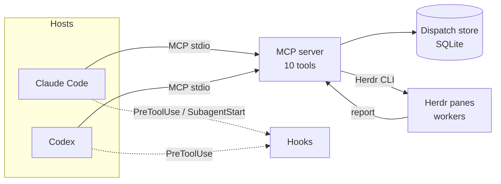

# agent-runtime

[](https://github.com/FBisca/agent-runtime/actions/workflows/ci.yml)

An MCP server that lets coding agents delegate work to other agents, as plain tool calls. Works with any coding agent that speaks MCP; tested with Claude Code and Codex.

A lead agent calls `spawn`, workers run in their own terminal panes, and every report, message and task flows through a durable local store instead of terminal text. Leads block on one `wait` and get results back as tool results, so orchestration stays deterministic, auditable and resumable across both CLIs.

## Architecture



- **MCP server** (`server/mcp_server.py`): serves the ten delegation tools over stdio.
- **Dispatch store** (`server/dispatch_store.py`): private, versioned SQLite. Holds assignments, reports, peer messages and shared tasks, with idempotent server-attributed events.
- **Runtime adapters** (`server/agent_runtime.py`): `resolve` picks `herdmates`, `hc` or `native` deterministically from the environment.
- **Hooks** (`hooks/`): a PreToolUse guard denies raw `hc` mutations and keeps subagents off the mutating tools; a SubagentStart hook tells native subagents what they may call.

## Features

- Ten tools: `spawn`, `message`, `resume`, `wait`, `status`, `list`, `collect`, `stop`, `report`, `task`.
- Reports and peer messages as tool results: `wait` returns reports and assignment states together, with `receipt` acknowledgements and `more` continuations that bound payload size.
- Durable shared tasks with dependencies and atomic claims (`task`).
- Idempotent reports: retries are safe, and senders are derived by the server, never self-declared.
- Failure hygiene: a failed spawn fails its assignment and releases its linked task.
- `status` and `collect` are diagnostic fallbacks and authorize against the store first.
- Standard library only.

## Hosts

The MCP server and the dispatch store are host-agnostic: any coding agent that speaks MCP over stdio can call the ten tools. Hosts are pluggable in that sense only. Claude Code and Codex are the only hosts tested, and there is no host registry or adapter interface: support for each is a handful of explicit branches. Adding a host today means editing these integration points:

| Concern | Where | What a new host provides |
|---|---|---|
| Host names | `CLIS` in `server/hc_tools.py`; the `cli` enum in `TOOLS` in `server/mcp_server.py`; the `--cli` choices in `server/agent_runtime.py` | a name |
| Launching a worker | `spawn` in `server/hc_tools.py` | the argv that starts the CLI non-interactively with the task text (Claude: `--agent implementer`; Codex: `--no-daemon` plus its implementer instructions) |
| Worker instructions | `codex_instructions` in `server/hc_tools.py`; for Claude, the agent file the host loads | where the host reads the implementer role from |
| Subagent wording | `SUBAGENT_TOOL` in `server/hc_tools.py` | the name of the host's own subagent tool, used in the `lookup` refusal |
| Detecting the host | `cli_of_args` (process name), `detect_cli` and `CODEX_ENV_MARKERS` (environment markers), `foreground_cli` (Herdr foreground program), all in `server/agent_runtime.py` | a process basename and/or environment variable that identifies it |
| Runtime choice | `resolve` in `server/agent_runtime.py` | which runtime (`herdmates` or `native`) the host gets under Herdr |
| Session identity | `dispatch_identity` in `server/hc_tools.py` | a session ID in the environment (today `CODEX_THREAD_ID` or `CLAUDE_SESSION_ID`); the lead's generation is derived from it |
| Reading its terminal | `hc_app` in `server/agent_runtime.py`, and `server/markers.json` | an app name (`claude-code`, `codex`) plus its prompt glyph, anchor and interrupt text, for `status` and `collect` |
| Hook protocol | `hooks/pre_tool_use.py` and `hooks/subagent_start.py` | a PreToolUse hook that sends JSON with `tool_name`, `tool_input` and `agent_id` for subagents; `TOOL_NAME` in the hook matches the plugin and plain `mcp__agent-runtime__` tool prefixes (the `--cli codex` argument Codex passes is not branched on) |
| MCP registration | `.mcp.json` and `hooks/hooks.json` (Claude plugin); the block printed by `install.sh` (Codex) | the host's own config entry for a stdio MCP server |

Spawning workers also requires Herdr's `hc` CLI whatever the host.

## Requirements

- Python 3.11+
- The Herdr `hc` CLI on `PATH` for spawning and driving worker panes
- Claude Code and/or Codex as the host

## Install

### Claude Code

From the public marketplace:

```
/plugin marketplace add FBisca/agent-runtime
/plugin install agent-runtime@agent-runtime
```

From a local clone, loaded in place so edits apply on the next session:

```sh
git clone https://github.com/FBisca/agent-runtime.git
```

```
/plugin marketplace add ./agent-runtime
/plugin install agent-runtime@agent-runtime
```

### Codex

Codex has no plugin marketplace, so it uses shims. `install.sh` links `agent-runtime`, `agent-runtime-hook` and `agent-runtime-mcp` into `~/.local/bin` (override with `BIN_DIR`) and prints a complete, ready-to-paste `~/.codex/config.toml` block. It is idempotent.

```sh
./install.sh
```

The block registers the MCP server with `AGENT_RUNTIME_DISPATCH=1`, a 600 s tool timeout and `approve` mode on the mutating tools (`spawn`, `message`, `resume`, `stop`, `report`, `task`), plus PreToolUse hooks for Bash and the runtime's own tools.

`agent-runtime resolve` shows which runtime a session resolves to; `status` and `list` inspect workers.

## Tests

```sh
python3 -B -m unittest discover -s tests
```

No dependencies. Tests drive the server over stdio against a fake `hc`. The live mixed-CLI acceptance run is opt-in (`AGENT_RUNTIME_LIVE=1`). CI runs the suite on Python 3.11 to 3.13 on Linux and macOS, and runs shellcheck on `install.sh` and `bin/`.

## How it is built

Spec- and plan-driven. [`docs/specs/agent-runtime.md`](docs/specs/agent-runtime.md) is the living contract: numbered WHEN/THEN requirements, each traced to a scenario and a test (requirements about a consuming repo's config are marked as moved there). [`docs/plans/`](docs/plans/) holds the archived plans that produced it, with their decisions and scenarios. Every behavior change starts as a scenario, is written red first, and lands with its requirement.

## License

[MIT](LICENSE)
