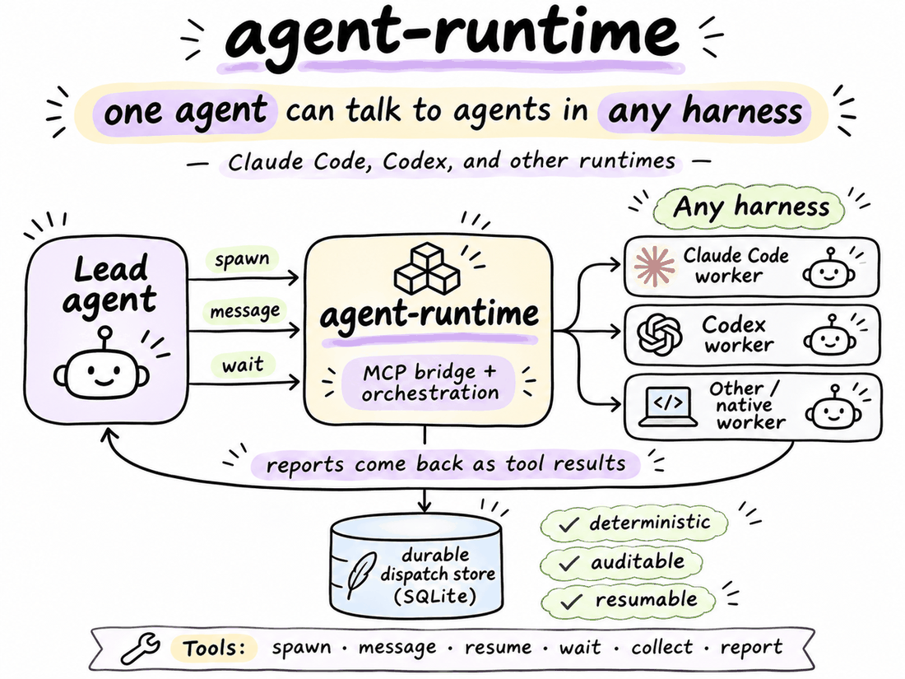
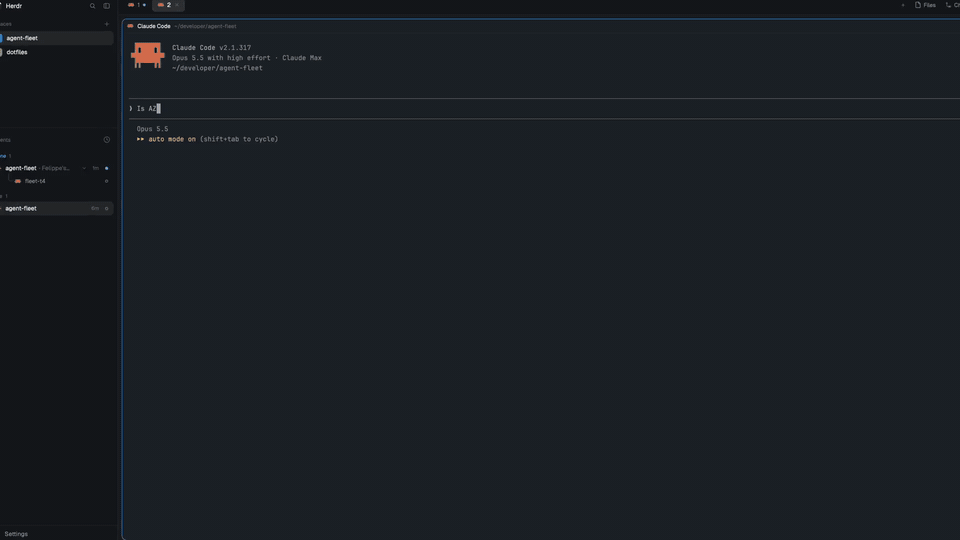

# agent-runtime

[](https://github.com/FBisca/agent-runtime/actions/workflows/ci.yml)

An MCP server that lets coding agents delegate work to other agents, as plain tool calls. Works with any coding agent that speaks MCP; tested with Claude Code and Codex.

A lead agent calls `spawn`, workers run in their own terminal panes, and every report, message and task flows through a durable local store instead of terminal text. Leads block on one `wait` and get results back as tool results, so orchestration stays deterministic, auditable and resumable across both CLIs.





*A Claude lead asks a Claude judge and a Codex judge the same question, then merges their verdicts ([full-quality MP4](docs/assets/demo.mp4)).*

## Architecture

- **MCP server** (`server/mcp_server.py`): serves the ten delegation tools over stdio.
- **Dispatch store** (`server/dispatch_store.py`): private, versioned SQLite. Holds assignments, reports, peer messages and shared tasks, with idempotent server-attributed events.
- **Runtime adapters** (`server/agent_runtime.py`): `resolve` picks `herdmates`, `hc` or `native` deterministically from the environment.
- **Hooks** (`hooks/`): a PreToolUse guard denies raw `hc` mutations and keeps subagents off the mutating tools; a SubagentStart hook tells native subagents what they may call; a context hook (Claude SessionStart `compact`/`clear` and UserPromptSubmit) reminds a lead to call `wait(all)` when it has undelivered messages or unseen working assignments, or to check `status` when delivered attention is unchanged. Lead hooks are read-only and fail open: they open the store `mode=ro`, never write, and print nothing on any error (shared helpers in `hooks/hook_lib.py`). Known limit: UserPromptSubmit may fire while a backgrounded `wait(all)` is in flight, so the reminder can repeat; the Stop guard (below) exempts a running backgrounded `wait`.

### Stop guard (Claude)

`hooks/stop_guard.py` refuses to end a lead's turn (`{"decision":"block"}`) while it has undelivered messages or working assignments it has not seen, telling it to call `wait(all)`. Blocked, decision, failed and already-reported stalled assignments never block. It blocks at most 3 times per user prompt: the count lives in a 0600 file under `$XDG_STATE_HOME/agent-runtime/stop-guard/` (never the dispatch store), is reset by UserPromptSubmit or by a Stop that finds nothing to block on, and when spent the guard allows with one stderr note. A running backgrounded agent-runtime `wait` (from the Stop payload's `background_tasks`) allows the stop without spending budget; the match is on server `agent-runtime` (plugin-scoped `plugin:<plugin>:agent-runtime` too) and tool `wait`, any non-terminal status, and any `wait` target (the target is not visible in the payload); an unrecognised payload shape just falls back to the budget. Every error allows. Known limit: if a backgrounded `wait` is cut off, the lead only notices on its next turn. The `background_tasks` shape (`server`/`tool` fields; plugin servers scoped `plugin:<plugin>:<server>`) is taken from the Claude hooks reference, not live-verified, because `claude -p` never backgrounds MCP calls; an unknown shape only loses the exemption, which the budget bounds.

### Codex lead hooks

The same guard and reminders run on Codex through the shim: `agent-runtime-hook stop --cli codex` (Stop) and `agent-runtime-hook context --cli codex` (SessionStart and UserPromptSubmit); with no subcommand the shim is still the PreToolUse guard. Codex payloads and outputs were probed against `codex-cli 0.166.0` (`docs/verification/codex-hooks.md`): the block and context shapes match Claude's, there is no `background_tasks` (so no wait exemption), and the 3-block budget bounds the guard. `CODEX_LEAD_HOOKS=1 ./install.sh` reprints the whole Codex config (including `[mcp_servers.agent-runtime]`) plus the lead hooks; copy ONLY the `[[hooks.Stop]]`, `[[hooks.SessionStart]]` and `[[hooks.UserPromptSubmit]]` blocks into `~/.codex/config.toml` yourself, then trust them with `/hooks`. Codex runs a hook only once it is trusted, and an untrusted one raises a "Hooks need review" prompt. Trust is positional: a stale `[hooks.state."…config.toml:session_start:0:0"]` entry left by an old, retired hook shows as changed and must be re-trusted or deleted. Then confirm a spawned Codex worker still starts its task, from inside an hc terminal: `AGENT_RUNTIME_LIVE_CODEX_HOOKS=1 python3 -B -m unittest discover -s tests -p test_live_acceptance.py -k spawned_codex_worker` (skipped unless `~/.codex/config.toml` has the Stop and context hooks).

## Features

- Ten tools: `spawn`, `message`, `resume`, `wait`, `status`, `list`, `collect`, `stop`, `report`, `task`.
- Reports and peer messages as tool results: `wait` returns reports and assignment states together, with `receipt` acknowledgements and `more` continuations that bound payload size.
- Pull-only delivery: reports landing after a `wait` returns need a new `wait(target=all)`. A lead's `spawn`, `resume` and `message` results carry `unfinished: N` and a `next` hint while N > 0.
- Durable shared tasks with dependencies and atomic claims (`task`).
- Idempotent reports: retries are safe, and senders are derived by the server, never self-declared.
- Failure hygiene: a failed spawn fails its assignment and releases its linked task.
- `status` and `collect` are diagnostic fallbacks and authorize against the store first.
- Standard library only.

## Hosts and servers

Two roles are swappable in principle, and neither has an adapter interface: the **host** (the coding agent that leads or works) and the **server** (the backend that runs worker sessions). Claude Code and Codex are the tested hosts; [Herdr](https://herdr.dev/core/)'s `hc` is the only supported server.

| Role | Supported today | Where it plugs in |
|---|---|---|
| Host | Claude Code, Codex | `CLIS`, `spawn`, `cli_of_args`, `detect_cli`, `dispatch_identity` and the hooks (see Hosts) |
| Server | Herdr `hc` | `hc` and `run` in `server/hc_tools.py`, `hc_get` and `run_command` in `server/agent_runtime.py` (see Servers) |

### Hosts

The MCP server and the dispatch store are host-agnostic: any coding agent that speaks MCP over stdio can call the ten tools. Hosts are pluggable in that sense only. Claude Code and Codex are the only hosts tested, and there is no host registry or adapter interface: support for each is a handful of explicit branches. Adding a host today means editing these integration points:

| Concern | Where | What a new host provides |
|---|---|---|
| Host names | `CLIS` in `server/hc_tools.py`; the `cli` enum in `TOOLS` in `server/mcp_server.py`; the `--cli` choices in `server/agent_runtime.py` | a name |
| Launching a worker | `spawn` in `server/hc_tools.py` | the argv that starts the CLI non-interactively with the task text (Claude: `--agent implementer`; Codex: `--no-daemon` plus its implementer instructions; an optional `model` adds `--model <model>` before the prompt; an optional `agent` replaces `implementer`: Claude `--agent <agent>`, Codex reads `~/.codex/agents/<agent>.toml`. An agent without the `report` tool leaves the lead seeing the worker as unreported or stalled) |
| Worker instructions | `codex_instructions` in `server/hc_tools.py`; for Claude, the agent file the host loads | where the host reads the implementer role from (Codex: `~/.codex/agents/<agent>.toml`, default `implementer`) |
| Subagent wording | `SUBAGENT_TOOL` in `server/hc_tools.py` | the name of the host's own subagent tool, used in the `lookup` refusal |
| Detecting the host | `cli_of_args` (process name), `detect_cli` and `CODEX_ENV_MARKERS` (environment markers), `foreground_cli` (Herdr foreground program), all in `server/agent_runtime.py` | a process basename and/or environment variable that identifies it |
| Runtime choice | `resolve` in `server/agent_runtime.py` | which runtime (`herdmates` or `native`) the host gets under Herdr |
| Session identity | `dispatch_identity` in `server/hc_tools.py` | the lead's generation is `<pid>:<lstart>` of the nearest Claude or Codex ancestor (`cli_generation` in `server/agent_runtime.py`, shared with hooks), so `/clear` and `/new` stay on one team; a session ID in the environment (`CODEX_THREAD_ID` or `CLAUDE_SESSION_ID`) is used only when no CLI ancestor is visible |
| Reading its terminal | `hc_app` in `server/agent_runtime.py`, and `server/markers.json` | an app name (`claude-code`, `codex`) plus its prompt glyph, anchor and interrupt text, for `status` and `collect` |
| Hook protocol | `hooks/pre_tool_use.py`, `hooks/subagent_start.py` and `hooks/lead_context.py` (helpers in `hooks/hook_lib.py`) | a PreToolUse hook that sends JSON with `tool_name`, `tool_input` and `agent_id` for subagents; `TOOL_NAME` in the hook matches the plugin and plain `mcp__agent-runtime__` tool prefixes (the `--cli codex` argument Codex passes is not branched on) |
| MCP registration | `.mcp.json` and `hooks/hooks.json` (Claude plugin); the block printed by `install.sh` (Codex) | the host's own config entry for a stdio MCP server |

Spawning workers also requires Herdr's `hc` CLI whatever the host.

### Servers

Worker panes are run by Herdr's [`hc`](https://herdr.dev/core/) CLI. There is no backend interface: `hc` is called directly, through two small helpers, so a new server replaces those calls. The dispatch store (reports, messages, tasks) is local SQLite and does not depend on the server; the server is only how workers are started, addressed, observed and stopped.

| Server job | Today's call | Where |
|---|---|---|
| Run helpers | every call goes through `hc` and `run` | `server/hc_tools.py` |
| Start a worker pane | `hc run --bg --name <n> --cwd <dir> --parent <id> --json <argv>` | `spawn` in `server/hc_tools.py` |
| Terminal state and identity | `hc get <id> --json` (name, parent, status, foreground argv) | `hc_get` in `server/agent_runtime.py`, with `hc_state` and `hc_record` there mapping the reply to a worker state |
| Send text to a terminal | `hc send [flags] <target> <text>` (prompts, resume, peer messages) | `server/hc_tools.py` |
| Read a screen | `hc read <n> --lines N` | `collect` in `server/hc_tools.py`; `run_command` in `server/agent_runtime.py` for `status` |
| Wait for news | `hc wait --children any\|all` or `hc wait <n>`, with `--timeout --json` | `wait` in `server/hc_tools.py` |
| List terminals | `hc ls --all --json` | `server/hc_tools.py`, `server/agent_runtime.py` |
| Stop and remove | `hc kill <n>`, `hc rm <n>` | `stop` in `server/hc_tools.py` |
| Terminal IDs and scope | `HC_TERMINAL_ID` is the caller's terminal; `hc_server` derives the scope from `HC_TERMINAL_SOCKET` (else `HC_SCOPE`) | `me` and `hc_server` in `server/hc_tools.py` |
| Screen markers | per-app prompt and interrupt text that tell idle from busy in a read screen | `server/markers.json` |

A new backend must provide: start a named background terminal under a parent and return its ID, report a terminal's state and parent, accept text input, return recent screen text, block until a child changes state, list terminals, and stop and remove one. The `hc`-specific reply shapes are parsed where listed above, so those parsers change with the backend. The `herdmates` and `native` runtimes in `resolve` are separate paths without `hc` and only offer status.

## Usage

Ask in plain words; the lead agent turns it into tool calls.

| You say | Lead calls |
|---|---|
| "Ask Codex to review this diff" | `spawn(kind="worker", cli="codex", name="codex-review", task=…, cwd=…)`, then `wait(target="all")` |
| "Have Claude and Codex both try this" | two `spawn`s (`cli="claude"`, `cli="codex"`), one `wait(target="all")` |
| "Tell the reviewer to also check tests" | `message(to="codex-review", text=…)` or `resume(name=…, task=…)` |
| "What is it doing?" | `status(name=…)`, then `collect` if it went quiet |

`cli` defaults to `claude`. Reports return as tool results; the lead never polls panes.

### CLI profiles

Define local worker profiles in `$XDG_CONFIG_HOME/agent-runtime/profiles.json` (default `~/.config/agent-runtime/profiles.json`), or set `AGENT_RUNTIME_PROFILES` to another path. The repository ships no configured profiles. For example:

```json
{
  "profiles": {
    "custom-worker": {
      "cli": "claude",
      "env": {
        "ANTHROPIC_BASE_URL": "https://provider.example/api",
        "ANTHROPIC_AUTH_TOKEN": "$WORKER_API_KEY"
      }
    }
  }
}
```

Use `spawn(cli="custom-worker", …)`. Each `tools/list` request publishes the built-ins plus the configured names. `cli` selects a `claude` or `codex` family; `model` and `agent` keep that family's normal behavior. Built-in `claude` and `codex` launch exactly as before.

Configured names run through the installed `bin/agent-runtime-profile <profile> -- <program> <args...>` launcher. It clears `ANTHROPIC_BASE_URL`, `ANTHROPIC_AUTH_TOKEN`, `ANTHROPIC_API_KEY`, `ANTHROPIC_MODEL`, `ANTHROPIC_DEFAULT_SONNET_MODEL`, `ANTHROPIC_DEFAULT_OPUS_MODEL` and `ANTHROPIC_DEFAULT_HAIKU_MODEL`, then applies the profile's env and execs the CLI. `$NAME` values expand only in the launcher's login-session environment. Store credentials there and reference them; resolved credentials never enter the config, launch argv or temporary files. Literal strings support nonsecret settings. Missing references fail with the launcher's diagnostic and leave no worker running.

The server and launcher's login session must select the same config file: if overriding `AGENT_RUNTIME_PROFILES` or `XDG_CONFIG_HOME`, set it for both. Unknown names and unsupported CLI families fail before `hc run`. Malformed config publishes only built-ins and returns an explicit error for configured spawns.

An opt-in live check uses an existing local profile, verifies its worker environment without printing values, and checks that `hc get` still identifies the CLI: `AGENT_RUNTIME_LIVE_PROFILE=<name> python3 -B -m unittest discover -s tests -p test_live_acceptance.py -k test_S17_S18_S19`. Run inside an hc terminal with the profile's references available in the login session.

## Requirements

- Python 3.11+
- The Herdr `hc` CLI on `PATH` for spawning and driving worker panes
- Claude Code and/or Codex as the host

## Install

### Claude Code

From the public marketplace:

```
/plugin marketplace add FBisca/agent-runtime
/plugin install agent-runtime@agent-runtime
```

From a local clone, loaded in place so edits apply on the next session:

```sh
git clone https://github.com/FBisca/agent-runtime.git
```

```
/plugin marketplace add ./agent-runtime
/plugin install agent-runtime@agent-runtime
```

### Codex

Codex has no plugin marketplace, so it uses shims. `install.sh` links `agent-runtime`, `agent-runtime-hook`, `agent-runtime-mcp` and `agent-runtime-profile` into `~/.local/bin` (override with `BIN_DIR`) and prints a complete, ready-to-paste `~/.codex/config.toml` block. It is idempotent.

```sh
./install.sh
```

The block registers the MCP server with `AGENT_RUNTIME_DISPATCH=1`, a 600 s tool timeout and `approve` mode on the mutating tools (`spawn`, `message`, `resume`, `stop`, `report`, `task`), plus PreToolUse hooks for Bash and the runtime's own tools.

`agent-runtime resolve` shows which runtime a session resolves to; `status` and `list` inspect workers.

## Tests

```sh
python3 -B -m unittest discover -s tests
```

No dependencies. Tests drive the server over stdio against a fake `hc`. The live mixed-CLI acceptance run is opt-in (`AGENT_RUNTIME_LIVE=1`). CI runs the suite on Python 3.11 to 3.13 on Linux and macOS, and runs shellcheck on `install.sh` and `bin/`.

## How it is built

Spec- and plan-driven. [`docs/specs/agent-runtime.md`](docs/specs/agent-runtime.md) is the living contract: numbered WHEN/THEN requirements, each traced to a scenario and a test (requirements about a consuming repo's config are marked as moved there). [`docs/plans/`](docs/plans/) holds the archived plans that produced it, with their decisions and scenarios. Every behavior change starts as a scenario, is written red first, and lands with its requirement.

## License

[MIT](LICENSE)
