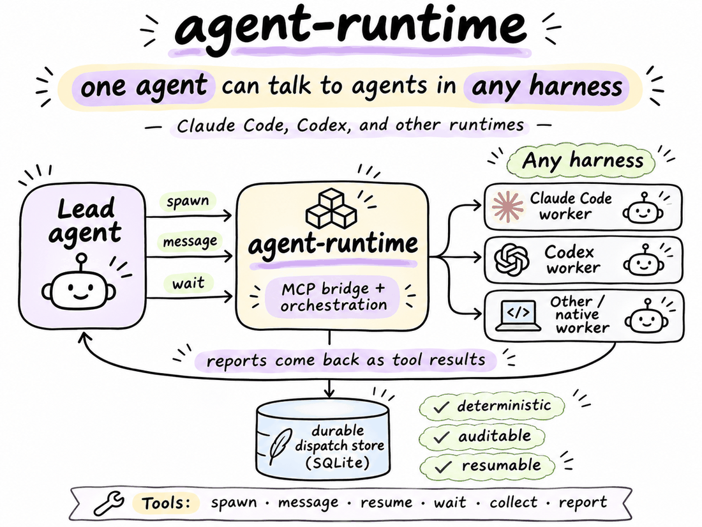

# Architecture

How agent-runtime is put together, how the hooks guard a lead, and where a new host or server would
plug in.

- [Components](#components)
- [Hooks](#hooks)
- [Hosts and servers](#hosts-and-servers)

## Components

- **MCP server** (`packages/agent-runtime/src/agent_runtime/mcp_server.py`): serves the ten delegation tools over stdio.
- **Dispatch store** (`packages/agent-runtime/src/agent_runtime/dispatch_store.py`): private, versioned SQLite. Holds assignments, reports, peer messages and shared tasks, with idempotent server-attributed events.
- **Runtime adapters** (`packages/agent-runtime/src/agent_runtime/agent_runtime.py`): `resolve` picks `herdmates`, `hc` or `native` deterministically from the environment.
- **Hooks** (`hooks/`): see [Hooks](#hooks).

What the tools guarantee:

- Reports and peer messages as tool results: `wait` returns reports and assignment states together, with `receipt` acknowledgements and `more` continuations that bound payload size.
- Early delivery: `wait(target=all)` returns as soon as a report is undelivered; `unfinished` names the assignments still open and the lead waits again for the rest.
- Pull-only delivery: reports landing after a `wait` returns need a new `wait(target=all)`. A lead's `spawn`, `resume` and `message` results carry `unfinished: N` and a `next` hint while N > 0.
- Durable shared tasks with dependencies and atomic claims (`task`).
- Idempotent reports: retries are safe, and senders are derived by the server, never self-declared.
- Failure hygiene: a failed spawn fails its assignment and releases its linked task.
- `status` and `collect` are diagnostic fallbacks and authorize against the store first.
- Standard library only.

The code is one uv workspace with two installable members and one lockfile: `packages/agent-runtime` (the standard-library-only runtime) and `packages/agent-orchestrator` (the typed engine, with Pydantic and PyYAML). The documented commands still live in `server/` and `bin/`, so the plugin, the installer's shims and the hooks are unchanged.

## Hooks

The hooks in `hooks/` are defence in depth; the CLI and the server are the authority.

- A **PreToolUse guard** denies raw `hc` mutations and keeps subagents off the mutating tools.
- A **SubagentStart hook** tells native subagents what they may call.
- A **context hook** (Claude SessionStart `compact`/`clear` and UserPromptSubmit) reminds a lead to call `wait(all)` when it has undelivered messages or unseen working assignments, or to check `status` when delivered attention is unchanged.

Lead hooks are read-only and fail open: they open the store `mode=ro`, never write, and print nothing on any error (shared helpers in `hooks/hook_lib.py`). Known limit: UserPromptSubmit may fire while a backgrounded `wait(all)` is in flight, so the reminder can repeat; the Stop guard (below) exempts a running backgrounded `wait`.

### Stop guard (Claude)

`hooks/stop_guard.py` refuses to end a lead's turn (`{"decision":"block"}`) while it has undelivered messages or working assignments it has not seen, telling it to call `wait(all)`. Blocked, decision, failed and already-reported stalled assignments never block. It blocks at most 3 times per user prompt: the count lives in a 0600 file under `$XDG_STATE_HOME/agent-runtime/stop-guard/` (never the dispatch store), is reset by UserPromptSubmit or by a Stop that finds nothing to block on, and when spent the guard allows with one stderr note. A running backgrounded agent-runtime `wait` (from the Stop payload's `background_tasks`) allows the stop without spending budget; the match is on server `agent-runtime` (plugin-scoped `plugin:<plugin>:agent-runtime` too) and tool `wait`, any non-terminal status, and any `wait` target (the target is not visible in the payload); an unrecognised payload shape just falls back to the budget. Every error allows. Known limit: if a backgrounded `wait` is cut off, the lead only notices on its next turn. The `background_tasks` shape (`server`/`tool` fields; plugin servers scoped `plugin:<plugin>:<server>`) is taken from the Claude hooks reference, not live-verified, because `claude -p` never backgrounds MCP calls; an unknown shape only loses the exemption, which the budget bounds.

### Codex lead hooks

The same guard and reminders run on Codex through the shim: `agent-runtime-hook stop --cli codex` (Stop) and `agent-runtime-hook context --cli codex` (SessionStart and UserPromptSubmit); with no subcommand the shim is still the PreToolUse guard. Codex payloads and outputs were probed against `codex-cli 0.166.0` ([`verification/codex-hooks.md`](verification/codex-hooks.md)): the block and context shapes match Claude's, there is no `background_tasks` (so no wait exemption), and the 3-block budget bounds the guard. Installing them is covered in [Install → Codex lead hooks](install.md#codex-lead-hooks).

## Hosts and servers

Two roles are swappable in principle, and neither has an adapter interface: the **host** (the coding agent that leads or works) and the **server** (the backend that runs worker sessions). Claude Code, Codex and Pi are the tested hosts; [Herdr](https://herdr.dev/core/)'s `hc` is the only supported server.

| Role | Supported today | Where it plugs in |
|---|---|---|
| Host | Claude Code, Codex, Pi (lead and worker) | `CLIS`, `spawn`, `cli_of_args`, `detect_cli`, `dispatch_identity` and the hooks (see Hosts) |
| Server | Herdr `hc` | `hc` and `run` in `packages/agent-runtime/src/agent_runtime/hc_tools.py`, `hc_get` and `run_command` in `packages/agent-runtime/src/agent_runtime/agent_runtime.py` (see Servers) |

### Hosts

The MCP server and the dispatch store are host-agnostic: any coding agent that speaks MCP over stdio can call the ten tools. Hosts are pluggable in that sense only. Claude Code, Codex and Pi are the tested hosts, and there is no host registry or adapter interface: support for each is a handful of explicit branches. Adding a host today means editing these integration points:

| Concern | Where | What a new host provides |
|---|---|---|
| Host names | `CLIS` in `packages/agent-runtime/src/agent_runtime/hc_tools.py`; the `cli` enum in `TOOLS` in `packages/agent-runtime/src/agent_runtime/mcp_server.py`; the `--cli` choices in `packages/agent-runtime/src/agent_runtime/agent_runtime.py` | a name |
| Launching a worker | `spawn` in `packages/agent-runtime/src/agent_runtime/hc_tools.py` | the argv that starts the CLI non-interactively with the task text (see [Launch flags](usage.md#launch-flags)) |
| Worker instructions | `codex_instructions` in `packages/agent-runtime/src/agent_runtime/hc_tools.py`; `spawn_instructions` for `instructions_file`; for Claude, the agent file the host loads | where the host reads the implementer role from (Codex: `~/.codex/agents/<agent>.toml` when explicitly selected) |
| Subagent wording | `SUBAGENT_TOOL` in `packages/agent-runtime/src/agent_runtime/hc_tools.py` | the name of the host's own subagent tool, used in the `lookup` refusal |
| Detecting the host | `cli_of_args` (process name), `detect_cli` and `CODEX_ENV_MARKERS`/`CLAUDE_ENV_MARKERS`/`PI_ENV_MARKERS` (environment markers), `foreground_cli` (Herdr foreground program), all in `packages/agent-runtime/src/agent_runtime/agent_runtime.py` | a process basename and/or environment variable that identifies it |
| Runtime choice | `resolve` in `packages/agent-runtime/src/agent_runtime/agent_runtime.py` | which runtime (`herdmates` or `native`) the host gets under Herdr |
| Session identity | `dispatch_identity` in `packages/agent-runtime/src/agent_runtime/hc_tools.py` | the lead's generation is `<pid>:<lstart>` of the nearest Claude, Codex or Pi ancestor (`cli_generation` in `packages/agent-runtime/src/agent_runtime/agent_runtime.py`, shared with hooks), so `/clear` and `/new` stay on one team; a session ID in the environment (`CODEX_THREAD_ID` or `CLAUDE_SESSION_ID`) is used only when no CLI ancestor is visible (a Pi lead never falls back to a session ID: it has no Pi process, so it has no session) |
| Host authorization | `host_of` and `authorize` in `packages/agent-runtime/src/agent_runtime/host_policy.py` | for a host whose trust model the runtime cannot inherit (Pi), what the session may mutate, which worker backends it may start and where |
| Reading its terminal | `hc_app` in `packages/agent-runtime/src/agent_runtime/agent_runtime.py`, and `packages/agent-runtime/src/agent_runtime/markers.json` | an app name (`claude-code`, `codex`) plus its prompt glyph, anchor and interrupt text, for `status` and `collect` |
| Hook protocol | `hooks/pre_tool_use.py`, `hooks/subagent_start.py` and `hooks/lead_context.py` (helpers in `hooks/hook_lib.py`) | a PreToolUse hook that sends JSON with `tool_name`, `tool_input` and `agent_id` for subagents; `TOOL_NAME` in the hook matches the plugin and plain `mcp__agent-runtime__` tool prefixes (the `--cli codex` argument Codex passes is not branched on) |
| MCP registration | `.mcp.json` and `hooks/hooks.json` (Claude plugin); the block printed by `install.sh` (Codex) | the host's own config entry for a stdio MCP server |

Spawning workers also requires Herdr's `hc` CLI whatever the host. Pi, the host the runtime authorizes itself, has its own page: [Pi](pi.md).

### Servers

Worker panes are run by Herdr's [`hc`](https://herdr.dev/core/) CLI. There is no backend interface: `hc` is called directly, through two small helpers, so a new server replaces those calls. The dispatch store (reports, messages, tasks) is local SQLite and does not depend on the server; the server is only how workers are started, addressed, observed and stopped.

| Server job | Today's call | Where |
|---|---|---|
| Run helpers | every call goes through `hc` and `run` | `packages/agent-runtime/src/agent_runtime/hc_tools.py` |
| Start a worker pane | `hc run --bg --name <n> --cwd <dir> --parent <id> --json <argv>` | `spawn` in `packages/agent-runtime/src/agent_runtime/hc_tools.py` |
| Terminal state and identity | `hc get <id> --json` (name, parent, status, foreground argv) | `hc_get` in `packages/agent-runtime/src/agent_runtime/agent_runtime.py`, with `hc_state` and `hc_record` there mapping the reply to a worker state |
| Send text to a terminal | `hc send [flags] <target> <text>` (prompts, resume, peer messages) | `packages/agent-runtime/src/agent_runtime/hc_tools.py` |
| Read a screen | `hc read <n> --lines N` | `collect` in `packages/agent-runtime/src/agent_runtime/hc_tools.py`; `run_command` in `packages/agent-runtime/src/agent_runtime/agent_runtime.py` for `status` |
| Wait for news | `hc wait --children any\|all` or `hc wait <n>`, with `--timeout --json` | `wait` in `packages/agent-runtime/src/agent_runtime/hc_tools.py` |
| List terminals | `hc ls --all --json` | `packages/agent-runtime/src/agent_runtime/hc_tools.py`, `packages/agent-runtime/src/agent_runtime/agent_runtime.py` |
| Stop and remove | `hc kill <n>`, `hc rm <n>` | `stop` in `packages/agent-runtime/src/agent_runtime/hc_tools.py` |
| Terminal IDs and scope | `HC_TERMINAL_ID` is the caller's terminal; `hc_server` derives the scope from `HC_TERMINAL_SOCKET` (else `HC_SCOPE`) | `me` and `hc_server` in `packages/agent-runtime/src/agent_runtime/hc_tools.py` |
| Screen markers | per-app prompt and interrupt text that tell idle from busy in a read screen | `packages/agent-runtime/src/agent_runtime/markers.json` |

A new backend must provide: start a named background terminal under a parent and return its ID, report a terminal's state and parent, accept text input, return recent screen text, block until a child changes state, list terminals, and stop and remove one. The `hc`-specific reply shapes are parsed where listed above, so those parsers change with the backend. The `herdmates` and `native` runtimes in `resolve` are separate paths without `hc` and only offer status.

Every worker stays interactive: no backend is spawned one-shot (`--print`, `-p`, `exec`), because the runtime resumes a live pane (`hc send` into the running terminal) and the driver resumes the same pane for a fix round. A one-shot worker cannot be sent to, so every fix round would restart from zero context. The suite fails if a backend is ever spawned headless.
