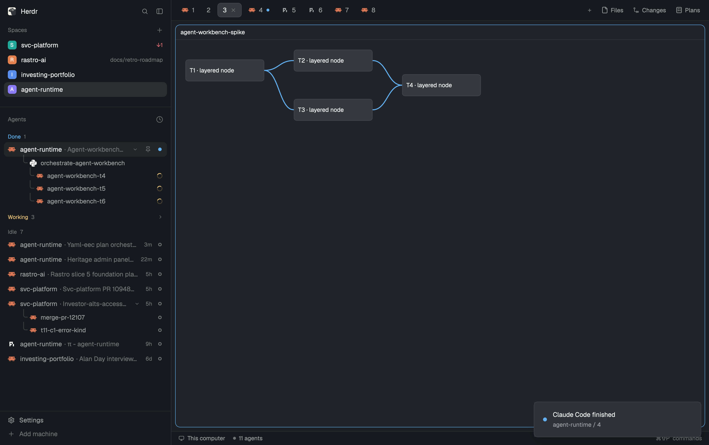

# Drawn-edge spike (T6, S20)

Throwaway mod `agent-workbench-spike` (kept outside the repository, in the scratchpad). Four ticket nodes placed with absolute `left`/`top`, two dependency edges per blocked-by pair drawn with `PathBuilder.stroke(2)` cubic beziers and `window.paint_path`.

## Finding

- **Drawable:** yes. `PathBuilder` + `window.paint_path` draw bezier edges between nodes in a real Herdr window.
- **Positionable:** yes. Absolutely positioned nodes land where computed; edge endpoints meet node sides.
- **Caveat:** `paint_path` is reached through the global `window`, not `cx`. Edges are painted in a separate absolute layer, so they do not move with node layout unless recomputed in `render`.
- `herdr-app check` passes for the prototype.

Screenshot (`herdr-app shot`): `docs/plans/2026-11-11-agent-workbench.spike.png`

## Decision

Edges are drawable, so a drawn-graph view is feasible.

Accepted by Felippe 2026-11-12: the S20 finding stands as written. Decision: a drawn-graph view gets no plan of its own. The layered list (D6) stays.
